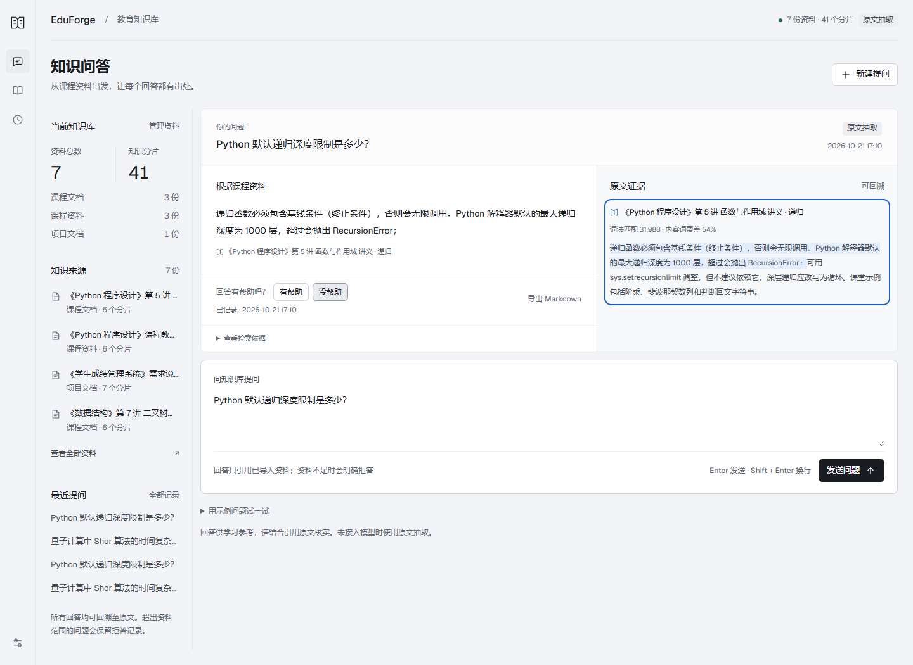

# EduForge 教育项目实战

三个独立项目：教育知识库、教学学情诊断与分层练习、知识库模型 LoRA 微调。源码使用 Python；两个 Web 应用使用 FastAPI、SQLite 和原生 HTML/CSS/JavaScript。

| 项目 | 功能 | 入口 |
|---|---|---|
| [教育知识库](01-edu-knowledge-base/README.md) | 资料导入、问答与原文引用、资料管理、反馈、历史及导出 | 本机 8001 |
| [学情诊断](02-learning-diagnostics/README.md) | CSV 导入、班级分析、失分证据、分层练习、人工复核与报告导出 | 本机 8002 |
| [LoRA 微调](03-kb-lora-finetune/README.md) | 训练、推理、独立评分脚本与真实 100 步 Qwen 训练报告 | 离线 HTML 报告 |

## 启动 Web 项目

Python 3.10+。在仓库根目录打开终端，每个项目单独安装依赖、启动：

```powershell
cd 01-edu-knowledge-base
python -m pip install -r requirements.txt
python run.py
```

打开 [教育知识库](http://127.0.0.1:8001)。默认空库；可主动使用 `python run.py --load-samples` 载入合成示例。

学情诊断在另一个终端执行：

```powershell
cd 02-learning-diagnostics
python -m pip install -r requirements.txt
python run.py
```

打开 [学情诊断](http://127.0.0.1:8002)，导入 CSV 或点击“使用合成示例”。



## 微调报告与公开范围

微调项目公开源码、配置、报告、训练曲线、截图及必要的运行证据，**不包含训练数据集、基座、adapter 权重或分词器**。下载仓库后可用浏览器打开 `03-kb-lora-finetune/reports/training-report.html`，其本地图片与证据链接完整。

已在本机 CPU 实际完成 Qwen2.5-0.5B-Instruct 的 100 步 LoRA 训练。原实验采用 12 份 AI 编写的合成来源、84 条模板样例，文档组划分为 56/14/14；它不是学校采集数据或经过教师标注验收的数据集。各集合共享模板、拒答题带情境标记，且 pilot 阶段已查看测试输出，结果不属于盲测或生产质量验收。

重新训练、数据构建或完整微调测试前，需自行准备符合脚本格式的合成来源，并另行下载基座与安装依赖。已有模型的许可和限制见各项目模型卡。

## 验证与截图

原交付已通过 51 / 26 / 11 项测试，另有 22 个子测试；两个 Web 应用真实浏览器检查为 17 / 11 项。此处保留原始测试结果，公开整理后的复核与敏感信息检查见 [公开前审查记录](SECURITY_REVIEW.md)。

32 张截图和训练曲线全部使用中文文件名，并直接放在各项目根目录。截图中的课程材料、学生姓名和成绩均为合成演示数据。字体及许可证保存在各 Web 项目的 `static/fonts/`。

## 使用范围

两个 Web 应用适合本机教学辅助和受控试用。多人上线前仍需补齐个人账号与数据隔离、备份恢复、服务运维和目标负载验证；规则诊断与模型输出都需要人工核对。当前 RAG 默认使用 BM25 词法检索及原文抽取，模型生成是可选配置；微调模型没有自动接入在线 RAG 服务。

发布目录不含实名提交包、聊天附件、运行数据库、`.env`、凭证、依赖目录或模型缓存。报告副本中的本机路径和主机信息已脱敏，训练指标与原始模型预测未改写。
